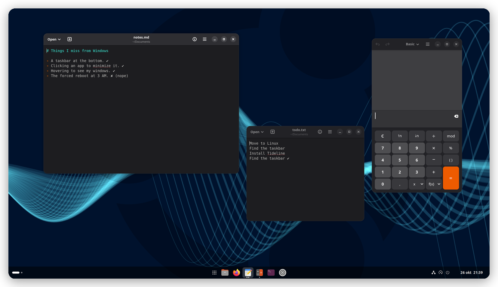
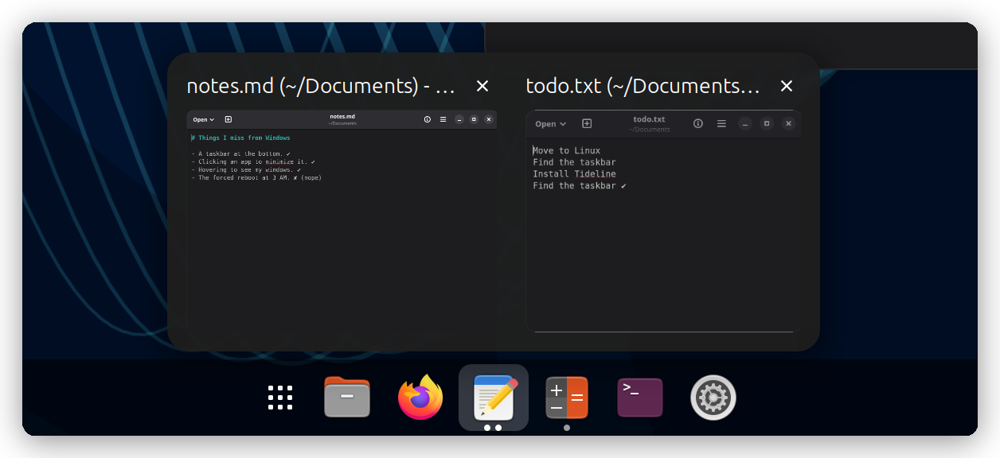
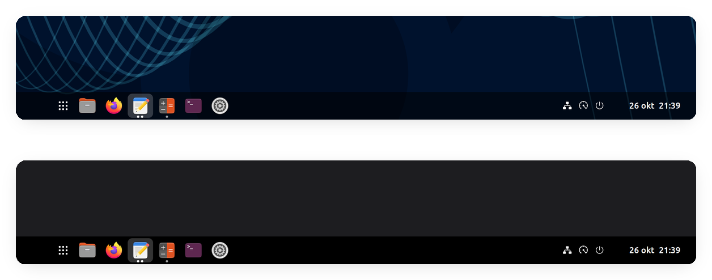
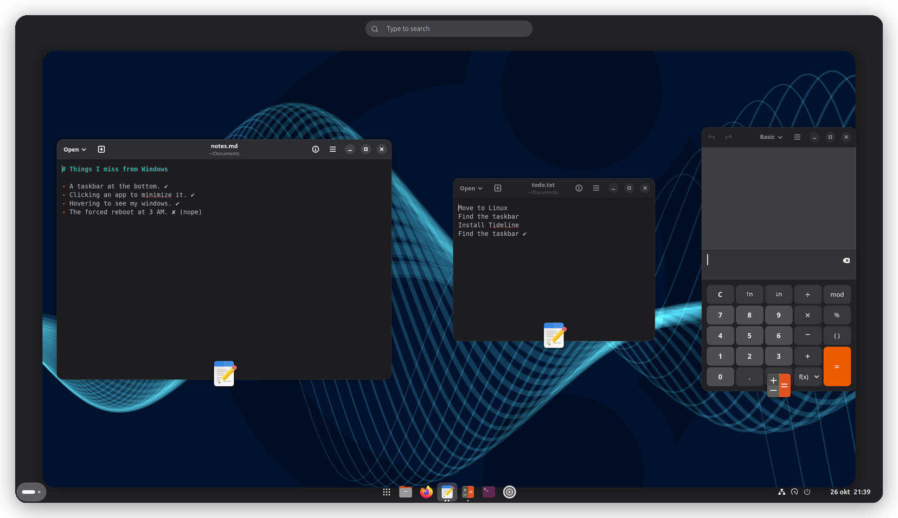
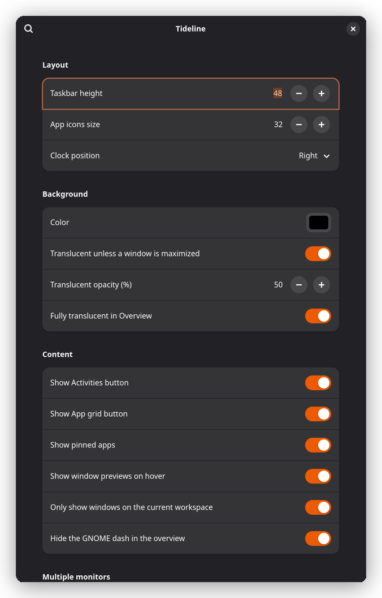

# Tideline

**A taskbar. At the bottom. Like nature (and Redmond) intended.**

Tideline combines the top panel and the dash in GNOME into a single taskbar at
the bottom of the screen in a no-nonsense style. Suits everyone that comes from
Windows and wants a similar workflow without all the bells and whistles.



## Why Tideline?

So you moved from Windows to Linux. Congratulations! Your files are yours, your
updates ask before rebooting, and nobody is trying to sell you a news feed.

But for the first few weeks your mouse keeps drifting to the bottom of the
screen, looking for a taskbar that isn't there. GNOME is lovely, it just
does things *its* way: a bar at the top, a dash that only shows up in the
overview, and a gentle suggestion that you rethink how you use a computer.

Tideline is for when you would rather not rethink anything. It gives you the
one thing your muscle memory actually asks for, a plain taskbar along the
bottom edge, and then stays out of the way.

It is deliberately **lean**:

- No Start menu clone, no widgets panel, no weather you didn't ask for.
- No theme that turns GNOME into Windows 95 (as tempting as that is).
- No forty pages of settings. A handful of switches, sensible defaults, done.

## What you get

| Your Windows habit | In Tideline |
|---|---|
| Taskbar at the bottom, apps in the middle | ✔ Pinned and running apps, centered |
| Click an app to switch to it, click again to minimize | ✔ And with several windows, each click moves to the next one |
| Hover an app to peek at its windows | ✔ Live previews, click to switch, × to close |
| Drag pinned apps into your favorite order | ✔ Drop a running app among the pins to pin it too |
| Clock and system icons in the bottom-right corner | ✔ Menus open upward, like they should down here |
| Windows shrink into the taskbar when minimized | ✔ Straight into their own app's button |
| A taskbar on every monitor | ✔ Extra monitors get just the apps, no clock clutter |
| The Start button | Sort of. The app grid button starts things. It just doesn't show ads. |


### Previews on hover

Hover a running app and its windows show up as live thumbnails. Click one to
jump to it, or close it right there.



### Translucent, until it matters

The bar is see-through when your desktop is on show and turns solid as soon as
a window is maximized, so nothing looks half-finished. Pick any color you like.



### Out of the way in the Overview

Press the Super key and GNOME's Overview still works the GNOME way. Tideline
fades to fully transparent so your windows get the spotlight, and the dash that
used to live there is hidden since the taskbar already does its job.



## Settings

Everything has a sensible default, so you can install it and forget about it.
If you do like to tinker:

- **Layout:** taskbar height, icon size, and whether the clock sits on the right
  or in the middle.
- **Background:** color, translucency, solid with maximized windows, fully
  transparent in the Overview.
- **Content:** Activities button, app grid button, pinned apps, window previews,
  windows from the current workspace only, hiding the GNOME dash.
- **Multiple monitors:** a taskbar on every monitor, optionally showing only
  that monitor's windows.



## Install

Tideline is tested on GNOME Shell 51.

```bash
./build.sh install
```

On Wayland, log out and back in so GNOME Shell sees the new extension. Then turn
off Ubuntu Dock (or Dash to Dock), because two docks at the bottom is one dock
too many, and turn Tideline on:

```bash
gnome-extensions disable ubuntu-dock@ubuntu.com
```

```bash
gnome-extensions enable tideline@croby.se
```

Preferences: `gnome-extensions prefs tideline@croby.se`

## Develop

The extension itself is in [`tideline@croby.se/`](tideline@croby.se). `./build.sh`
packs it into `tideline@croby.se.shell-extension.zip`; `./build.sh install`
also installs it for your user.

Run a nested shell in a window so a crash doesn't take down your session:

```bash
gnome-shell --devkit --wayland
```

Logs: `journalctl -f -o cat /usr/bin/gnome-shell`

## Not done yet

- The bar does not hide automatically. It is a taskbar, it likes to be seen.
- No keyboard navigation for window previews yet.

## License

GPL-2.0-or-later, the same as GNOME Shell. See [LICENSE](LICENSE).
