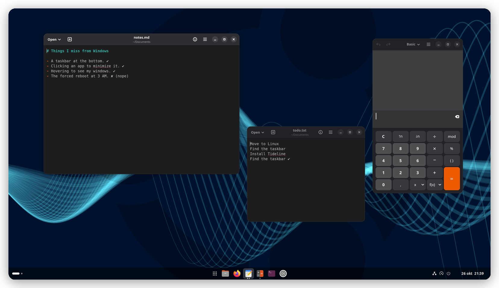
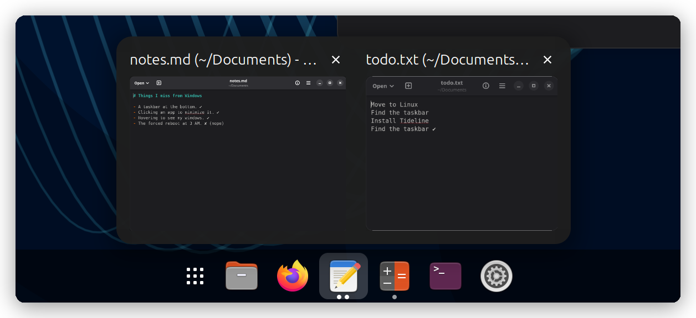
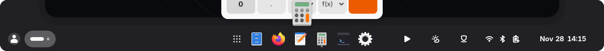
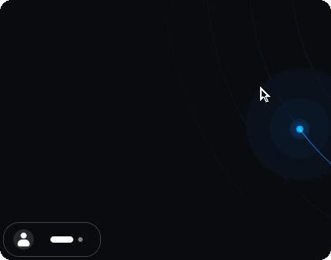
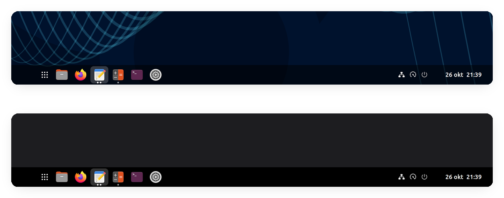
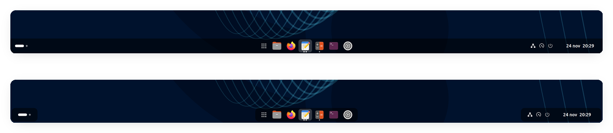
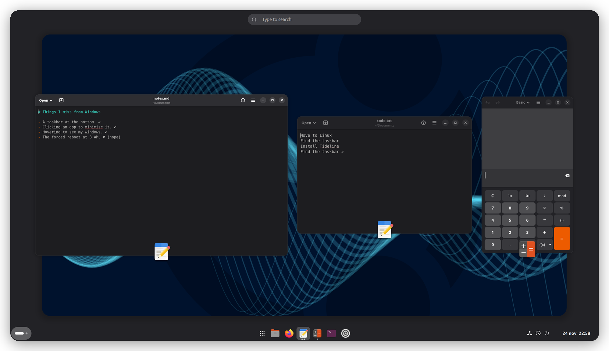
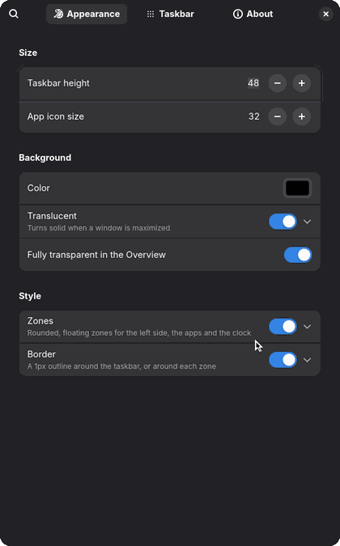

# Tideline

**A taskbar. At the bottom. Like nature (and Redmond) intended.**

Tideline combines the top panel and the dash in GNOME into a single taskbar at
the bottom of the screen in a no-nonsense style. Suits everyone that comes from
Windows and wants a similar workflow without all the bells and whistles.

> [!NOTE]
> **Made with AI.** Tideline was built in collaboration with
> [Claude Code](https://claude.com/claude-code), Anthropic's AI coding
> assistant. I came up with the ideas, tried every change on my own desktop and
> sent it back when it wasn't right; Claude wrote most of the code. If you'd
> rather keep your desktop free of AI-written code, no hard feelings, this is
> your exit sign. 👋



## Why Tideline?

So you moved from Windows to Linux. Congratulations! Your files are yours, your
updates ask before rebooting, and nobody is trying to sell you a news feed.

But for the first few weeks your mouse keeps drifting to the bottom of the
screen, looking for a taskbar that isn't there. GNOME is lovely, it just
does things *its* way: a bar at the top, a dash that only shows up in the
overview, and a gentle suggestion that you rethink how you use a computer.

Tideline is for when you would rather not rethink anything. It gives you the
one thing your muscle memory actually asks for, a plain taskbar along the
bottom edge, and then stays out of the way.

It is deliberately **lean**:

- No Start menu clone, no widgets panel, no weather you didn't ask for.
- No theme that turns GNOME into Windows 95 (as tempting as that is).
- No forty pages of settings. Three tidy tabs, sensible defaults, done.

## What you get

| Your Windows habit | In Tideline |
|---|---|
| Taskbar at the bottom, apps in the middle | ✔ Pinned and running apps, centered |
| Click an app to switch to it, click again to minimize | ✔ And with several windows, each click moves to the next one |
| Hover an app to peek at its windows | ✔ Live previews, click to switch, × to close |
| Drag pinned apps into your favorite order | ✔ Drop a running app among the pins to pin it too |
| Clock and system icons in the bottom-right corner | ✔ Menus open upward, like they should down here |
| Windows shrink into the taskbar when minimized | ✔ Straight into their own app's button |
| A taskbar on every monitor | ✔ Extra monitors get just the apps, no clock clutter |
| "Show hidden icons" when the tray fills up | ✔ A crowded bar tucks the system icons behind an arrow next to the clock, and a long row of apps scrolls instead of spilling over |
| Your picture, power and sign-out in the Start menu | ✔ A round user button on the far left: edit your profile, suspend, restart, power off or log out |
| The Start button | Sort of. The app grid button starts things. It just doesn't show ads. |


### Previews on hover

Hover a running app and its windows show up as live thumbnails. Click one to
jump to it, or close it right there.



### Room for everything

Twenty apps open and a tray full of extension icons? Tideline keeps the three
parts of the bar from ever running into each other. When it gets crowded, the
right side folds down to just the clock and an arrow, like "Show hidden icons"
on Windows; click the arrow to bring the icons back. The apps in the middle get
all the room that's left, and when even that isn't enough, the row scrolls:
use the arrows at its ends or your mouse wheel. The app you switch to always
scrolls into view.



### You, and the power button

Your picture sits in the bottom-left corner, roughly where Windows puts its
Start button. Click it to edit your profile, or to suspend, restart, power off
or log out, without digging through the system menu.



### Translucent, until it matters

The bar is see-through when your desktop is on show and turns solid as soon as
a window is maximized, so nothing looks half-finished. Windows tiled to fill
the screen between them (say, with Tiling Assistant) count too. Pick any color
you like.



### One bar, or three zones

Prefer something a little more modern? Turn on **Zones** and the bar splits
into three rounded, slightly floating islands: your picture and Activities on
the left, apps in the middle, clock on the right. Tweak the roundness, float height, gaps and
padding to taste. Maximize a window and it quietly turns back into one solid
bar, because nobody wants to see wallpaper peeking out under their
spreadsheet.



### Out of the way in the Overview

Press the Super key and GNOME's Overview still works the GNOME way. Tideline
fades to fully transparent so your windows get the spotlight, the Overview
moves up to make room for it, and the dash that used to live there is hidden
since the taskbar already does its job.



## Settings

Everything has a sensible default, so you can install it and forget about it.
If you do like to tinker, right-click an empty spot on the taskbar (or the app
grid button) and choose **Tideline Settings**. Options that come with extra
knobs keep them folded away until you switch them on.

- **Appearance:** taskbar height and icon size; background color, translucency
  (solid with maximized windows) and full transparency in the Overview;
  **Zones** with adjustable roundness, float height, edge gaps and padding;
  an optional 1px **Border** with its own color and opacity.
- **Taskbar:** the user, Activities and app grid buttons; pinned apps, window
  previews, windows from the current workspace only and the window dot color;
  a taskbar on every monitor, optionally with only that monitor's windows;
  hiding the GNOME dash in the Overview.
- **About:** the version you're running, plus links to this page, the issue
  tracker and the license.



## Install

Tideline is tested on GNOME Shell 51.

Grab `tideline@croby.se.shell-extension.zip` from the
[latest release](https://github.com/tobcro/tideline/releases/latest) and install it:

```bash
gnome-extensions install --force tideline@croby.se.shell-extension.zip
```

Or build it from a clone of this repository:

```bash
./build.sh install
```

On Wayland, log out and back in so GNOME Shell sees the new extension. Then turn
off Ubuntu Dock (or Dash to Dock), because two docks at the bottom is one dock
too many, and turn Tideline on:

```bash
gnome-extensions disable ubuntu-dock@ubuntu.com
```

```bash
gnome-extensions enable tideline@croby.se
```

Preferences: `gnome-extensions prefs tideline@croby.se`

## Develop

The extension itself is in [`tideline@croby.se/`](tideline@croby.se). `./build.sh`
packs it into `tideline@croby.se.shell-extension.zip`; `./build.sh install`
also installs it for your user.

Run a nested shell in a window so a crash doesn't take down your session:

```bash
gnome-shell --devkit --wayland
```

Logs: `journalctl -f -o cat /usr/bin/gnome-shell`

## Not done yet

- The bar does not hide automatically. It is a taskbar, it likes to be seen.
- No keyboard navigation for window previews yet.

## License

GPL-2.0-or-later, the same as GNOME Shell. See [LICENSE](LICENSE).
