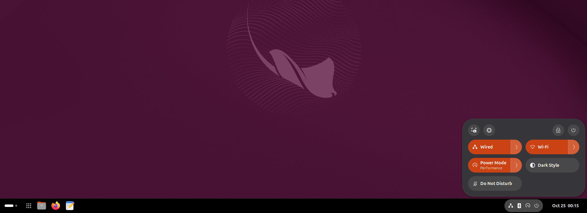

# Tideline

A GNOME Shell extension (tested on GNOME Shell 51) that merges the top panel
and the dash into one taskbar at the bottom of the screen.



## What it does

- Moves the top panel to the bottom edge and makes it taller (48 px by default).
- Puts pinned and running apps in the middle of the panel.
  - Click: open the app, focus its window, or minimize it if it already has focus.
    With several windows, each click switches to the next one.
  - Middle-click or Ctrl+click: open a new window.
  - Scroll: switch between the app's windows.
  - Right-click: the usual app menu (pin/unpin, windows, actions).
  - Dots under the icon show how many windows are open.
  - Windows minimize into their app's button and grow back out of it.
  - Hover a running app to see live previews of its windows. Click a preview to
    switch to it, or use its × to close the window.
  - Drag pinned apps to reorder them. Dropping a running app or an icon from the
    app grid among the pinned apps pins it.
- Adds an app grid button.
- Moves the clock to the right, next to the system menu.
- Makes every panel menu (quick settings, calendar, tray icons) open upward.
- Hides the dash in the overview, since the taskbar replaces it.
- Background is black (any colour can be picked) and 50% opaque, and turns solid while a maximized window is on
  that monitor. It becomes fully transparent in the overview.
- Every other monitor gets its own bar along the bottom with just the apps
  (no clock, system menus or Activities). It can show all windows, or only the
  windows on that monitor.

All of this can be changed in the preferences.


## Install

```bash
./build.sh install
```

On Wayland, log out and back in so GNOME Shell sees the new extension. Then turn
off Ubuntu Dock (or Dash to Dock) and turn this one on:

```bash
gnome-extensions disable ubuntu-dock@ubuntu.com
```

```bash
gnome-extensions enable tideline@croby.se
```

Preferences: `gnome-extensions prefs tideline@croby.se`

## Develop

The extension itself is in [`tideline@croby.se/`](tideline@croby.se). `./build.sh`
packs it into `tideline@croby.se.shell-extension.zip`; `./build.sh install`
also installs it for your user.

Run a nested shell in a window so a crash doesn't take down your session:

```bash
gnome-shell --devkit --wayland
```

Logs: `journalctl -f -o cat /usr/bin/gnome-shell`

## Not done yet

- The bar does not hide automatically, and there is no keyboard navigation
  for window previews.

## License

GPL-2.0-or-later, the same as GNOME Shell. See [LICENSE](LICENSE).
